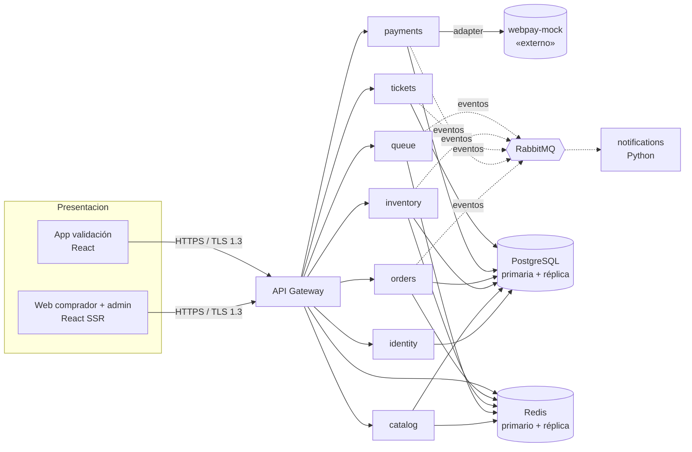

# AGENTS.md — Guía para trabajar en este repositorio

Este archivo es la **puerta de entrada** para cualquier persona o agente (Claude, Codex, etc.) que
trabaje en el repo. Léelo completo antes de tocar código.

La **fuente de verdad de la arquitectura** es la presentación del curso _Arquitectura de Software UDP_
(«Plataforma de e-commerce y ticketing — modelo de vistas 4+1», octubre 2026), transcrita y extendida en
[`docs/architecture/README.md`](docs/architecture/README.md). Si el código y ese documento discrepan,
**manda el documento**: corrige el código, o propone el cambio de arquitectura con un ADR nuevo antes de
implementarlo.

---

## 1. Misión

Plataforma web para vender **entradas a eventos y productos**, donde organizadores y vendedores
administran su oferta. La demanda llega en picos: miles de personas compiten por la misma entrada al
abrir una venta. **Sobrevender o cobrar dos veces destruye la confianza del cliente.**

Metas de calidad (no negociables):

| Meta | Valor | ASR |
| --- | --- | --- |
| Disponibilidad de catálogo y checkout | **99,9 %**, failover ≤ 5 s sin perder sesión ni carrito | ASR01 |
| Usuarios concurrentes en peaks | **≥ 10.000** con consulta y compra operativas | ASR02 |
| Sobreventa de entradas | **0 %**; reserva exclusiva de 10 min; liberación < 500 ms | ASR03 |
| Seguridad | TLS 1.3 en tránsito; credenciales con Argon2id; pago tokenizado e idempotente | ASR04 |
| Modificabilidad | Nuevo tipo de producto/funcionalidad **sin alterar** el código base de los servicios | ASR05 |

## 2. Regla principal: todo es propio (sin proveedores externos)

El prototipo actual (`src/`) nació en Lovable y depende de **Supabase** (Postgres como API REST, Auth,
RLS, `auth.admin`). Nuestro trabajo es **reemplazar cada capacidad de un proveedor externo por un
microservicio propio**. Se permiten librerías open source bien mantenidas; **no** se permiten servicios
gestionados de terceros (Supabase, Firebase, Auth0, Clerk, Stripe, SendGrid, Algolia, S3 gestionado, etc.).

| Capacidad que hoy da un tercero | La reemplaza | Notas |
| --- | --- | --- |
| Supabase Postgres + PostgREST | PostgreSQL propio + acceso desde cada servicio (SQL/Kysely) | Cada servicio es dueño de su esquema |
| Supabase Auth (signup, login, JWT, refresh) | **identity-service** | Argon2id, JWT EdDSA + JWKS, refresh rotativo |
| Row Level Security (`auth.uid()`, `has_role`) | Autorización explícita en gateway + servicios | Nunca confiar en el cliente |
| `auth.admin.listUsers/createUser` | identity-service (API admin) | Roles: `customer`, `organizer`, `seller`, `staff`, `admin` |
| Assets en CDN de Lovable / Supabase Storage | **media** (módulo de catalog-service) en Postgres + caché de Nginx (ADR-09) | Re-codificación a WebP, validación por contenido, tamaño máximo |
| Envío de correos (inexistente hoy) | **notifications-service** (Python) + SMTP propio (Mailpit en dev) | Plantillas HTML, cola, reintentos |
| Cron de Supabase | Jobs dentro de cada servicio con lock distribuido (Redis) | Expiración de reservas, conciliación |
| Fila virtual simulada (`Math.random`) | **queue-service** real sobre Redis | Ver §5 y `docs/services/virtual-queue.md` |
| Pago simulado (`status: "paid"` directo) | **payments-service** real | Única excepción: el adquirente (Webpay) es mock |

**Única excepción permitida:** la llamada al **adquirente** (Webpay / Transbank). Se implementa como
`webpay-mock`, un servicio que imita la API de Webpay Plus (create → redirect → commit → status → refund).
Regla de decisión del mock, según el email del comprador:

- `*@acceptme.com` → transacción **autorizada**.
- `*@rejectme.com` → transacción **rechazada**.
- Cualquier otro dominio → **rechazada** con motivo `UNSUPPORTED_TEST_EMAIL` (configurable con
  `WEBPAY_MOCK_DEFAULT_OUTCOME`).

Todo lo demás —reservas, órdenes, idempotencia, ledger, reembolsos, emisión de entradas, correos, fila
virtual, validación en puerta— **debe funcionar de verdad**.

## 3. Arquitectura en una página

Resumen; el detalle con diagramas está en [`docs/architecture/README.md`](docs/architecture/README.md).



### Servicios (un servicio por dominio, ADR-05)

| Servicio | Dominio / responsabilidades | RF | Stack |
| --- | --- | --- | --- |
| `gateway` | Entrada única: TLS, rate limiting, verificación de JWT (JWKS), verificación del token de admisión de la fila, CORS/CSRF, enrutamiento, request-id | — | Node 22 + TS + Fastify |
| `identity` | Registro, login, logout, refresh, verificación de email, recuperación de contraseña, roles, API admin de usuarios | RF01, RF02 | Node + TS |
| `catalog` | Eventos, fechas, recintos, sectores, butacas, productos (`ItemVendible`), media, caché de lectura | RF03, RF04, RF13, RF14 | Node + TS |
| `queue` | **Fila virtual**: sala de espera, posición, admisión por cupos, token de admisión | — (ASR02) | Node + TS + Redis |
| `inventory` | Disponibilidad y **reservas** (bloqueo pesimista, 10 min, expiración perezosa + barrido) | RF05, RF07 | Node + TS |
| `orders` | Carrito, checkout, órdenes, promociones; orquesta la saga de compra | RF06, RF08, RF10, RF12 | Node + TS |
| `payments` | Intentos de pago, idempotencia, adapter del adquirente, ledger, reembolsos, conciliación | RF09 | Node + TS |
| `webpay-mock` | Imita Webpay Plus. **Único mock.** | — | Node + TS |
| `tickets` | Emisión asíncrona de entradas (QR firmado), historial, **check-in atómico** | RF11, RF12, RF15 | Node + TS |
| `notifications` | Consume eventos y envía correos (confirmación, entradas, cuenta) | — | Python 3.12 |
| `@shared/commons` | Tipos, interfaces (`ItemVendible`), logger, errores, cliente de eventos, utilidades de seguridad | — | TS (librería) |

### Decisiones de arquitectura vigentes (ADR)

| ADR | Decisión | Archivo |
| --- | --- | --- |
| ADR-01 | Redundancia sin estado: contenedores en 2 zonas tras balanceador con health checks; Postgres con réplica síncrona y failover; sesión y carrito en Redis replicado | [`docs/adr/ADR-01`](docs/adr/ADR-01-redundancia-sin-estado.md) |
| ADR-02 | Caché de lectura (Redis, TTL de segundos) para catálogo, eventos y stock público; autoescalado; **toda escritura va a la BD** | [`docs/adr/ADR-02`](docs/adr/ADR-02-cache-y-autoescalado.md) |
| ADR-03 | Reserva con bloqueo pesimista: `SELECT … FOR UPDATE`, `expira_en = now() + 10 min`, expiración perezosa | [`docs/adr/ADR-03`](docs/adr/ADR-03-reserva-bloqueo-pesimista.md) |
| ADR-04 | Seguridad en capas: TLS 1.3, pago tokenizado con clave de idempotencia, OAuth 2.0 / JWT con roles, Argon2id | [`docs/adr/ADR-04`](docs/adr/ADR-04-seguridad-en-capas.md) |
| ADR-05 | Servicios por dominio tras API Gateway; contratos OpenAPI / AsyncAPI; `ItemVendible` como punto de extensión | [`docs/adr/ADR-05`](docs/adr/ADR-05-servicios-por-dominio.md) |
| ADR-06 | **Fila virtual** con Redis y token de admisión firmado (agregada; no estaba en la presentación) | [`docs/adr/ADR-06`](docs/adr/ADR-06-fila-virtual.md) |
| ADR-07 | Adquirente detrás de un adapter; Webpay como mock por dominio de email | [`docs/adr/ADR-07`](docs/adr/ADR-07-adquirente-mock.md) |
| ADR-08 | Sesión web como BFF: tokens en cookies HttpOnly, nunca en el navegador | [`docs/adr/ADR-08`](docs/adr/ADR-08-sesion-web-bff.md) |
| ADR-09 | Imágenes del catálogo en Postgres, re-codificadas a WebP y cacheadas en el borde | [`docs/adr/ADR-09`](docs/adr/ADR-09-media-en-postgres.md) |

## 4. Flujo de compra (vista de procesos)

1. **Fila** (solo si el evento la tiene activa): el comprador entra a la sala de espera; cuando le toca,
   `queue` emite un **token de admisión** (JWT, ventana de N min, ligado a usuario + evento).
2. **Agregar entrada** (RF06·RF07): `inventory` bloquea la fila (`FOR UPDATE`) y crea una reserva
   exclusiva que vence en 10 min. Requiere el token de admisión.
3. **Confirmar compra** (RF08): `orders` crea la orden `PENDING_PAYMENT` con montos calculados en el
   servidor y pide el cobro a `payments` **con clave de idempotencia**.
4. **Autorizar** (RF09): `payments` crea la transacción en el adquirente (`webpay-mock`), redirige, y al
   volver hace `commit`.
5. `alt` **pago aprobado antes del vencimiento** → `orders` genera la orden (RF10) → `inventory` marca
   la reserva `VENDIDA` → se publica `OrdenConfirmada` → `tickets` emite las entradas en forma asíncrona
   (RF11) → `notifications` envía el correo.
6. `alt` **pago rechazado o reserva vencida** → se libera la reserva (< 500 ms) y la compra no se completa.
   Si el pago se aprobó con la reserva ya vencida, se **reembolsa automáticamente**.

Secuencia completa con la fila: [`docs/architecture/README.md#vista-de-procesos`](docs/architecture/README.md#vista-de-procesos).

## 5. Fila virtual (resumen)

Diseño completo: [`docs/services/virtual-queue.md`](docs/services/virtual-queue.md).

- Redis `ZSET` por evento (FIFO por número de llegada; quienes llegan antes de la apertura se
  **aleatorizan** al abrir, para que no gane quien refresca más rápido).
- Un **admisor** con lock de líder admite cada segundo `cupos_libres = concurrent_slots − activos`.
- Admisión = **token firmado** (EdDSA, `sub`, `evt`, `jti`, `exp`). El gateway lo verifica e
  `inventory`/`orders` comprueban además que el `jti` siga activo (permite expulsar).
- El cliente consulta su estado con _backoff_ indicado por el servidor (`Retry-After`); posición con
  `ZRANK` (O(log n)) y ETA a partir de la tasa real de admisión.
- **Simulador de carga** en `tools/queue-simulator`: genera miles de bots que entran a la fila, esperan,
  reservan y pagan (mezcla `@acceptme.com` / `@rejectme.com`). Verifica **0 sobreventas** y reporta
  latencias p50/p95/p99.

## 6. Servicio de pagos (resumen)

Especificación completa: [`docs/services/payments.md`](docs/services/payments.md). Lo mínimo:

- Montos **siempre** calculados en el servidor desde la orden; CLP como **enteros** (`bigint`), nunca float.
- Máquina de estados explícita del intento de pago y **clave de idempotencia** obligatoria en cada POST.
- Adapter `PaymentProvider` (`create`, `commit`, `status`, `refund`); hoy lo implementa `webpay-mock`.
- **Ledger append-only** de doble entrada; tabla de auditoría; patrón **outbox** para publicar `PagoProcesado`.
- Conciliación: consulta `status` al adquirente para transacciones en estado incierto; reembolso
  automático si el pago llega con la reserva vencida.
- Nunca se almacenan PAN, CVV ni fecha de expiración (el formulario de tarjeta vive en el adquirente).

## 7. Estructura del repositorio (objetivo)

```
apps/
  web/                 # web comprador + admin (hoy: src/ en la raíz, TanStack Start)
  scanner/             # app de validación en puerta (RF15)
services/
  gateway/  identity/  catalog/  queue/  inventory/
  orders/   payments/  webpay-mock/  tickets/
  notifications/       # Python
packages/
  commons/             # @shared/commons: tipos, ItemVendible, logger, errores, eventos
  contracts/           # OpenAPI (HTTP) y AsyncAPI (eventos) — fuente de los tipos generados
infra/
  docker-compose.yml   # postgres (primaria+réplica), redis (+réplica), rabbitmq, mailpit, servicios
  nginx/               # balanceador / terminación TLS 1.3 local
tools/
  queue-simulator/     # bots / prueba de carga de la fila y la compra
docs/
  architecture/  adr/  services/
```

Estado (Fases 1 a 6 completas): existen `packages/commons`, `packages/contracts`, `infra/`,
`services/template`, `services/identity`, `services/gateway`, `services/catalog`,
`services/queue`, `services/inventory`, `services/orders`, `services/payments`,
`services/webpay-mock`, `services/tickets`, `apps/scanner` y `tools/queue-simulator`; la web
compra de punta a punta vía gateway (sesión BFF, catálogo, fila, reservas, carro, checkout, pago en
Webpay simulado y entradas con QR) y el personal valida en puerta con `apps/scanner`. Correos
(Fase 7) pendientes; las métricas del panel aún en Supabase. Para crear un servicio: `npm run new:service -- <nombre>` (copia la plantilla y su contrato).
Comandos y servicios locales: [`README.md`](README.md).

Mientras dure la migración, la app actual sigue en `src/`. Se migra con patrón **strangler**: cada
server function de `src/lib/*.functions.ts` pasa a llamar al gateway en vez de a Supabase, dominio por
dominio, y al final se elimina `@supabase/supabase-js` y la carpeta `supabase/`.

## 8. Reglas de implementación

### Seguridad (ASR04)
- **Nunca** confíes en datos del cliente para precios, totales, descuentos, estado de orden o identidad.
- Contraseñas con **Argon2id** (parámetros OWASP vigentes). JWT de acceso corto (≤ 15 min) firmado con
  EdDSA; refresh token opaco, rotativo, guardado hasheado y revocable; cookies `HttpOnly; Secure; SameSite`.
- Autorización por rol **y** por propiedad del recurso en cada endpoint (reemplaza a RLS).
- Validación de entrada con **Zod** en el borde de cada servicio; respuestas de error sin filtrar internos.
- Rate limiting en gateway (por IP y por usuario) y límites más estrictos en login, registro y fila.
- Secretos solo por variables de entorno / secret store; nunca en el repo. Mantén `.env.example` al día.
- Códigos (orden, entrada, tokens) con `crypto.randomBytes` / `randomUUID`, **nunca** `Math.random`.
- Logs estructurados sin datos sensibles (sin contraseñas, tokens ni datos de tarjeta).

### Consistencia (ASR03)
- Toda operación que cambia inventario, órdenes o pagos va en **una transacción** de BD.
- Contadores con `UPDATE … SET x = x + n WHERE x + n <= limite` o `FOR UPDATE`; nunca leer-modificar-escribir en la app.
- Restricciones únicas en BD como última línea de defensa (una reserva/venta activa por butaca y fecha).
- Eventos de dominio vía **outbox** (misma transacción que el cambio) y consumidores **idempotentes**.

### Escalabilidad y disponibilidad (ASR01, ASR02)
- Servicios **sin estado**: nada en memoria que no se pueda perder; sesión, carrito y fila en Redis.
- Lecturas públicas cacheadas (TTL de segundos); escrituras siempre a Postgres primaria.
- Cada servicio expone `GET /health/live` y `GET /health/ready`, y apaga limpio con `SIGTERM`.
- Timeouts, reintentos con backoff + jitter y _circuit breaker_ en llamadas entre servicios.

### Modificabilidad (ASR05)
- Un servicio no lee la base de datos de otro. Se comunica por **HTTP (OpenAPI)** o **eventos (AsyncAPI)**.
- Los contratos viven en `packages/contracts` y se versionan; un cambio incompatible exige versión nueva.
- Nuevos tipos de producto implementan `ItemVendible` (`packages/commons`) sin tocar `orders` ni `payments`.

### Calidad
- TypeScript `strict`. Tests con **Vitest**: unitarios del dominio e integración contra Postgres/Redis
  reales (docker compose). Los casos de concurrencia (sobreventa, doble cobro, idempotencia) son obligatorios.
- Cada servicio: `README.md` corto, `Dockerfile`, migraciones versionadas, `.env.example`.
- Antes de commitear: `lint`, `typecheck`, `test` y `build` del paquete tocado
  (`npm run lint:backend`, `npm run typecheck`, `npm test`, `npm run build:backend`).
- Pruebas de integración: `npm run infra:up` y las variables `TEST_DATABASE_URL`, `TEST_REDIS_URL`,
  `TEST_AMQP_URL` (ver `packages/commons/README.md`). Sin ellas se omiten; en CI siempre corren.
- Toda librería del backend usa `zod` 4; la web (`src/`) sigue en `zod` 3 hasta migrarla.

## 9. Convenciones de git

- Commits de **una sola línea**, en formato _Conventional Commits_ (`feat:`, `fix:`, `chore:`, `docs:`,
  `refactor:`, `test:`). **Sin cuerpo, sin `Co-Authored-By` y sin mencionar herramientas de IA.**
- Autor: la identidad del integrante que hace el cambio.
- Ramas por funcionalidad; integración a `main` vía pull request.
- No se suben secretos, `.env`, `node_modules` ni artefactos de build.

## 10. Hoja de ruta

Estado y fases detalladas en [`roadmap.md`](roadmap.md). Orden acordado:

0. Documentación y arquitectura (este archivo, `docs/`).
1. Monorepo + infraestructura local (`docker compose`) + `@shared/commons` + `contracts`.
2. `identity` + `gateway` (reemplaza Supabase Auth y RLS).
3. `catalog` (con media y caché) + migración de datos semilla.
4. `inventory` (reservas ADR-03) + `queue` (ADR-06) + simulador.
5. `orders` + `payments` + `webpay-mock` (saga de compra completa).
6. `tickets` (QR firmado, check-in) + app `scanner`.
7. `notifications` (Python).
8. Corte final: la web usa solo el gateway; se elimina Supabase. Pruebas de carga y de failover.

## 11. Preguntas abiertas

- **Frontend**: la presentación indica _React / Next.js_; el prototipo usa **TanStack Start** (React con
  SSR). Se mantiene TanStack Start salvo que el equipo decida migrar (requiere ADR).
- **Broker**: la presentación dice _RabbitMQ / Kafka_; se elige **RabbitMQ** por simplicidad operativa y
  colas con reintentos/DLQ. Revisar si aparece necesidad de _event sourcing_ o replay masivo.
- **Productos (e-commerce)**: RF03 y RF14 aún no existen en el prototipo (solo entradas). Se modelan
  como `ItemVendible` en `catalog`.
