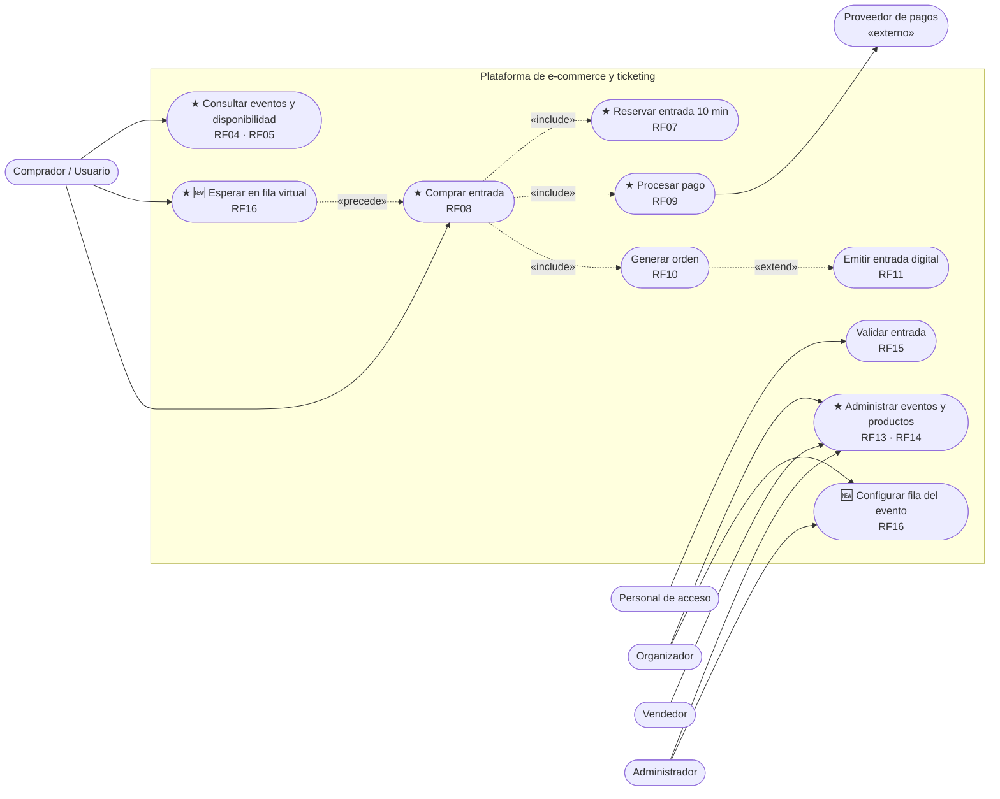
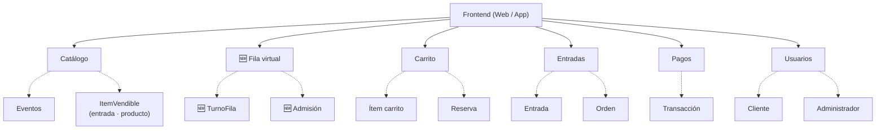
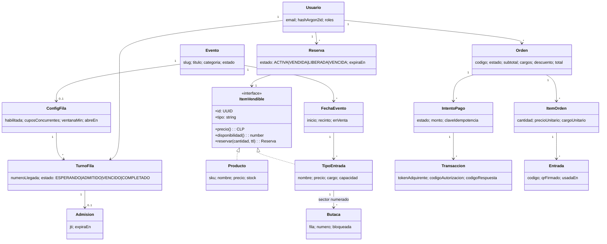
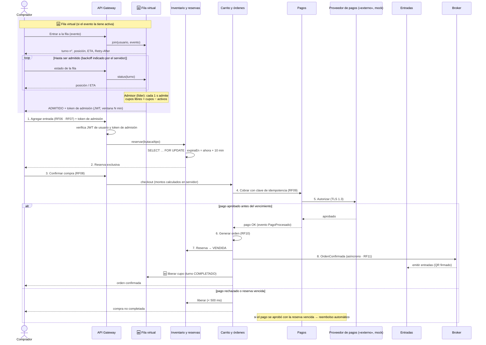
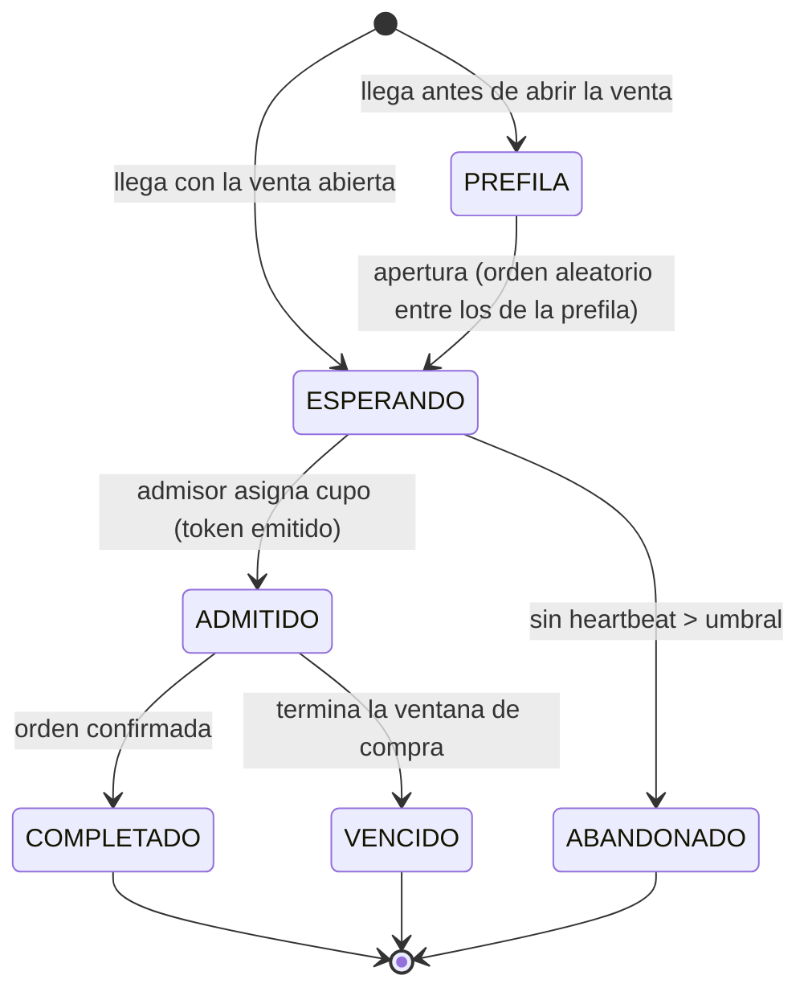
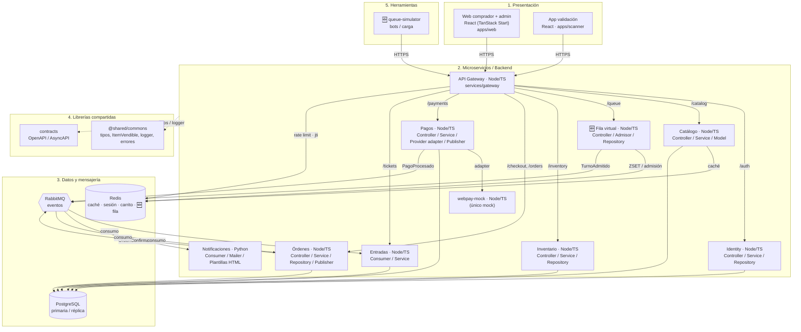
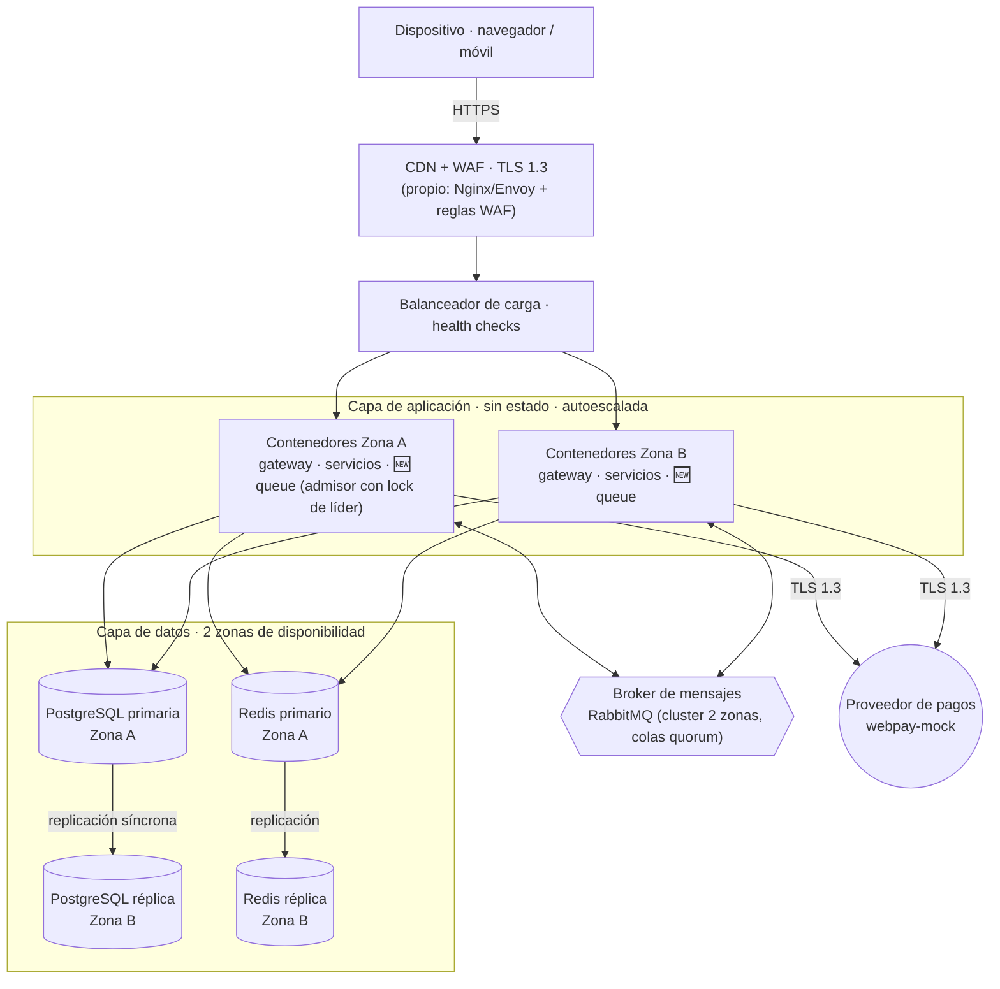

# Arquitectura — Plataforma de e-commerce y ticketing (modelo 4+1)

Transcripción de la presentación _Arquitectura de Software UDP — Sección 2 — octubre 2026_
(Lucas Abello, Nicolas Gaete, Ariel Jimenez, Cristóbal Oyarce), **extendida con la fila virtual**, que no
estaba en los diagramas originales. Las partes nuevas están marcadas con **🆕 Fila virtual**.

Este documento es la fuente de verdad. Los cambios se hacen con un ADR en [`../adr`](../adr).

---

## 1. Negocio y stakeholders

Plataforma web que vende productos y entradas a eventos, donde organizadores y vendedores administran su
oferta. La demanda llega en picos: miles de personas compiten por la misma entrada al abrir una venta.
Sobrevender o cobrar dos veces destruye la confianza del cliente.

| Meta de calidad | Valor |
| --- | --- |
| Disponibilidad de catálogo y checkout | 99,9 % |
| Usuarios concurrentes en peaks | 10.000 |
| Sobreventa de entradas | 0 % |

| Stakeholder | Concern |
| --- | --- |
| Comprador / usuario | Compra rápida y segura, sin doble cobro; **🆕 fila justa y transparente (posición y espera estimada)** |
| Organizador de eventos | Evitar la sobreventa; ventas actualizadas; **🆕 controlar la tasa de admisión de su venta** |
| Vendedor / comercio | Inventario consistente; órdenes correctas |
| Administrador | Sistema operativo; gestionar incidencias |
| Proveedor de pagos | Operaciones seguras y sin duplicados |
| Personal de acceso | Validar rápido; rechazar entradas usadas |
| Desarrollo y mantenimiento | Cambiar sin afectar otros componentes |
| Arquitecto de software | Trazabilidad entre concerns y decisiones |
| Operación (DevOps / SRE) | Desplegar y recuperarse sin cortes |
| Seguridad (SecOps) | Cifrado, control de acceso y auditoría; **🆕 frenar bots en la fila** |

## 2. Requerimientos funcionales → ASR

| Requerimiento funcional | Valor neg. | Impacto arq. | Por qué sí / por qué no |
| --- | :-: | :-: | --- |
| **RF01 Registro** | M | **A** | Credenciales cifradas en reposo |
| **RF02 Autenticación** | A | **A** | Sesión segura que sobrevive al failover |
| **RF03 Catálogo** | A | **A** | 99,9 % y 10.000 usuarios: réplicas y caché |
| **RF04 Eventos** | A | **A** | Pico de tráfico al abrir cada venta |
| **RF05 Disponibilidad** | A | **A** | Stock en caché; la reserva, siempre en la BD |
| **RF06 Carrito** | A | **A** | Persiste ante fallas; agregar = reservar |
| **RF07 Reserva** | A | **A** | Bloqueo exclusivo 10 min; liberar < 500 ms |
| **RF08 Compra** | A | **A** | Checkout bajo carga y sin sobreventa |
| **RF09 Pago** | A | **A** | TLS 1.3, sin doble cobro; si falla, libera |
| RF10 Generar orden | A | B | Ocurre dentro de la transacción de RF08 |
| RF11 Entrada digital | A | B | Asíncrona tras el pago; tolera segundos |
| RF12 Historial | M | B | Lectura propia, sin métrica de calidad |
| **RF13 Admin. eventos** | M | **A** | Nuevos tipos de evento sin tocar servicios |
| **RF14 Admin. productos** | M | **A** | Nuevos tipos de producto sin tocar servicios |
| RF15 Validar entrada | A | M | Marcado atómico; sin métrica propia |
| **🆕 RF16 Fila virtual** | A | **A** | Absorbe el pico de apertura (ASR02) y protege la reserva (ASR03); justicia y anti-bots |

**RF16 — Fila virtual.** Cuando un evento tiene la fila activa, el sistema deberá ubicar a cada comprador
en una sala de espera ordenada, informarle su posición y espera estimada, y admitir compradores a la
compra a una tasa controlada (cupos concurrentes), entregando a cada admitido una ventana de compra de
duración configurable. Sin admisión válida no se puede reservar ni pagar entradas de ese evento.

## 3. ASR y decisiones (ADR)

| ASR · escenario medible | ADR · decisión | Costo aceptado |
| --- | --- | --- |
| **ASR01 Disponibilidad** — 99,9 % en catálogo y checkout; ante una caída, tráfico a respaldo en ≤ 5 s sin perder sesión ni carrito | **ADR-01 Redundancia sin estado** — contenedores sin estado en 2 zonas tras un balanceador con health checks; PostgreSQL con réplica síncrona y failover automático; sesión y carrito en Redis replicado | Menos simplicidad; más costo de infraestructura y complejidad operativa |
| **ASR02 Escalabilidad** — ≥ 10.000 usuarios concurrentes al abrir ventas, con consulta y compra operativas | **ADR-02 Caché de lectura + autoescalado** — Redis como caché de lectura (TTL de segundos) para catálogo, eventos y stock público; autoescalado horizontal; toda escritura va a la BD | El stock público se muestra con segundos de retraso |
| | **🆕 ADR-06 Fila virtual** — sala de espera en Redis con admisión por cupos y token de admisión firmado; solo los admitidos llegan a reservar | Espera para el comprador; un componente crítico más (Redis) en la ruta de compra |
| **ASR03 Consistencia** — 0 % de sobreventa: reserva exclusiva de 10 min; sin pago, se libera en < 500 ms | **ADR-03 Reserva con bloqueo pesimista** — `SELECT … FOR UPDATE` sobre la entrada y `expiraEn = ahora + 10 min`; una reserva vencida deja de contar al consultarla (expiración perezosa) | Bloqueos estrictos: más latencia y menor rendimiento en los peaks (mitigado por ADR-06) |
| **ASR04 Seguridad** — TLS 1.3 en tránsito; credenciales protegidas en reposo con algoritmos estándar | **ADR-04 Seguridad en capas** — TLS 1.3 de punta a punta; pago tokenizado en el proveedor con clave de idempotencia; OAuth 2.0 / JWT con roles; contraseñas con Argon2id | Cifrar y validar cada transacción agrega carga |
| | **🆕 ADR-07 Adquirente detrás de un adapter** — `PaymentProvider` con implementación `webpay-mock` (decide por dominio del email) | El mock no ejercita la red real de Transbank |
| **ASR05 Modificabilidad** — integrar un nuevo tipo de producto o funcionalidad sin alterar el código base de los servicios | **ADR-05 Servicios por dominio + contratos** — un servicio por dominio tras un API Gateway; contratos OpenAPI / AsyncAPI y eventos; interfaz `ItemVendible` como punto de extensión | Más interfaces y módulos: mayor complejidad y tiempo de desarrollo inicial |

---

## Vista de escenarios (+1)

Casos de uso significativos. Los marcados con ★ ejercen un ASR.

## Vista lógica

Dominios que ve el frontend y sus entidades principales.

Modelo de clases (núcleo):

## Vista de procesos

Secuencia de compra. La parte 🆕 (fila virtual) precede a la secuencia original de la presentación.

Ciclo de vida de un turno de la fila:

## Vista de desarrollo

Componentes del código y sus dependencias.

## Vista física

Notas de despliegue:

- En local todo corre con `infra/docker-compose.yml` (Postgres primaria + réplica, Redis + réplica,
  RabbitMQ, Mailpit como SMTP, Nginx con TLS 1.3 haciendo de balanceador).
- Failover de Postgres y Redis: Patroni / Sentinel (o equivalente) en producción; los servicios usan
  _connection strings_ que apuntan al líder vigente.
- La fila depende de Redis: si Redis cae, la fila se **cierra** (los nuevos esperan con reintento) en vez
  de admitir sin control. Prefiere disponibilidad parcial a sobreventa.

## Trazabilidad

| Concern | Stakeholder | ASR | ADR |
| --- | --- | --- | --- |
| Evitar interrupciones durante una venta | Comprador / Administrador | ASR01 | ADR-01 |
| Soportar alta cantidad de compradores | Comprador / Organizador | ASR02 | ADR-02, ADR-06 |
| Fila justa, sin bots | Comprador / Organizador / SecOps | ASR02, ASR04 | ADR-06 |
| Evitar venta duplicada de una entrada | Organizador / Comprador | ASR03 | ADR-03 |
| Proteger las transacciones, sin doble cobro | Comprador / Proveedor de pagos | ASR04 | ADR-04, ADR-07 |
| Permitir evolución de la plataforma | Desarrollo / Vendedores / Organizadores | ASR05 | ADR-05 |
