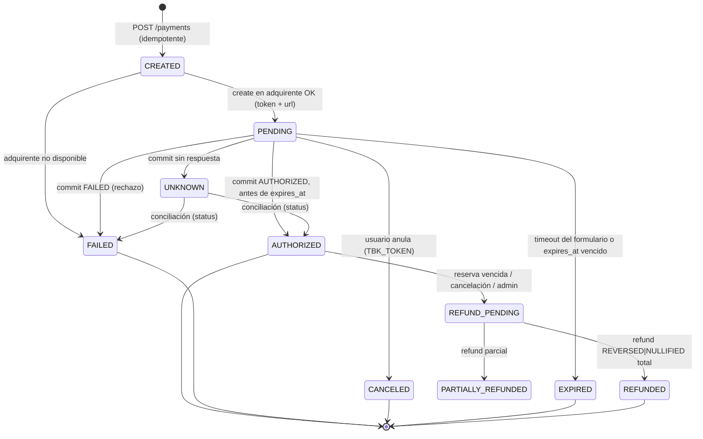

# payments-service — Pagos (RF09 · ASR04 · ADR-04 · ADR-07)

Responsable de cobrar **exactamente una vez** el monto correcto de una orden, de registrar cada
movimiento de dinero y de resolver los casos de falla (rechazo, abandono, timeout, respuesta perdida,
pago tardío). Todo es real excepto el **adquirente**, que se reemplaza por `webpay-mock`.

Reemplaza a `createOrder` del prototipo, que hoy inserta la orden directamente con `status: "paid"` y
un formulario de tarjeta precargado que no se envía a ninguna parte.

---

## 1. Responsabilidades

| # | Capacidad | Por qué |
| --- | --- | --- |
| 1 | **Intentos de pago** con máquina de estados explícita | Saber siempre en qué punto está cada cobro |
| 2 | **Idempotencia** en toda operación que mueve dinero | Sin doble cobro ante reintentos, doble clic o timeouts |
| 3 | **Monto desde el servidor**: se obtiene de `orders`, nunca del cliente | Evitar manipulación de precios |
| 4 | **Adapter de adquirente** (`PaymentProvider`) | Cambiar Webpay mock ↔ Webpay real ↔ otro sin tocar el dominio (ASR05) |
| 5 | **Flujo con redirección** (Webpay Plus): crear → redirigir → volver → confirmar | Es el flujo real del adquirente chileno |
| 6 | **Tokenización / sin datos de tarjeta**: el formulario vive en el adquirente | Reduce el alcance PCI DSS (equivalente a SAQ A) |
| 7 | **Ledger append-only de doble entrada** | Auditoría contable; los saldos se derivan, no se editan |
| 8 | **Reembolsos** totales y parciales (anulación / reversa) | Cancelaciones, pago tardío, devoluciones admin |
| 9 | **Conciliación**: consulta de estado al adquirente y cierre diario | Resolver estados inciertos y detectar diferencias |
| 10 | **Expiración** ligada a la reserva (10 min) | Si la reserva vence, no se puede seguir cobrando |
| 11 | **Pago tardío**: aprobado con la reserva ya vencida → reembolso automático | Nunca cobrar sin entregar |
| 12 | **Eventos** `PagoAutorizado`, `PagoRechazado`, `PagoReembolsado` vía **outbox** | Consistencia entre servicios sin transacciones distribuidas |
| 13 | **Auditoría** de cada cambio de estado (quién, cuándo, desde qué IP, request-id) | ASR04 / SecOps |
| 14 | **Antifraude básico**: límites de velocidad por usuario/IP/tarjeta, monto máximo por orden | Mitigar abuso y testing de tarjetas |
| 15 | **Seguridad de callbacks**: validar token contra el adquirente, nunca confiar en query params | El retorno del navegador es manipulable |
| 16 | **Observabilidad**: métricas de tasa de aprobación, latencia del adquirente, estados atascados | Detectar incidentes en ventas masivas |

Fuera de alcance (documentado para el futuro): cuotas sin interés configurables, OneClick
(tarjetas guardadas), split de pagos a organizadores/vendedores (_marketplace payouts_), boleta
electrónica SII (debería vivir en un servicio de facturación propio).

## 2. Webpay Plus (referencia del flujo real que imitamos)

API REST de Transbank (Webpay Plus), autenticada con headers `Tbk-Api-Key-Id` y `Tbk-Api-Key-Secret`:

| Operación | Llamada | Respuesta relevante |
| --- | --- | --- |
| Crear | `POST /rswebpaytransaction/api/webpay/v1.2/transactions` `{buy_order, session_id, amount, return_url}` | `{token, url}` — se redirige al usuario a `url` con `token_ws` |
| Confirmar | `PUT /…/transactions/{token}` | `{status: AUTHORIZED\|FAILED, response_code, authorization_code, amount, buy_order, card_detail.card_number (últimos 4), payment_type_code, installments_number, transaction_date, accounting_date, vci}` |
| Estado | `GET /…/transactions/{token}` | Mismo cuerpo; sirve para conciliar si se perdió la respuesta del commit |
| Reembolso | `POST /…/transactions/{token}/refunds` `{amount}` | `{type: REVERSED\|NULLIFIED, authorization_code, nullified_amount, balance}` |

Retornos posibles al `return_url`:

| Caso | Parámetros recibidos | Acción |
| --- | --- | --- |
| Flujo normal (aprobado o rechazado) | `token_ws` | Hacer **commit** y decidir según `status` y `response_code` (0 = aprobado) |
| Usuario anula en el formulario | `TBK_TOKEN`, `TBK_ORDEN_COMPRA`, `TBK_ID_SESION` | Marcar `CANCELED`, **no** hacer commit |
| Timeout del formulario | `TBK_ORDEN_COMPRA`, `TBK_ID_SESION` | Marcar `EXPIRED` |
| Error en el formulario | `token_ws` **y** `TBK_TOKEN` | Marcar `FAILED`, consultar estado |

Restricciones: `buy_order` ≤ 26 caracteres, `session_id` ≤ 61, `amount` en CLP entero. El commit debe
hacerse pronto tras el retorno; si no llega respuesta, se consulta `status` (no se reintenta el commit
a ciegas).

## 3. webpay-mock (único mock del sistema)

Servicio aparte que expone **la misma API y los mismos retornos** que la sección 2, más una página de
pago propia (`GET /webpay/form?token_ws=…`) con botones _Pagar_ y _Anular_.

**Regla de decisión** al hacer commit, según el email del pagador:

| Email del comprador | Resultado |
| --- | --- |
| `*@acceptme.com` | `AUTHORIZED`, `response_code: 0`, `authorization_code` aleatorio, tarjeta `XXXX6623` |
| `*@rejectme.com` | `FAILED`, `response_code: -1` (rechazo del emisor) |
| otro dominio | `FAILED`, motivo `UNSUPPORTED_TEST_EMAIL` (configurable con `WEBPAY_MOCK_DEFAULT_OUTCOME=accept\|reject`) |

Cómo llega el email: en `create`, `payments` envía el header de extensión `X-Mock-Payer-Email`
(Webpay real no lo recibe; el adapter real simplemente no lo manda). El mock lo guarda junto al token.

Opcionales para pruebas de resiliencia (activables por env, apagados por defecto): latencia
artificial, respuesta perdida en commit (para probar la conciliación por `status`) y error 5xx
intermitente.

## 4. Modelo de datos (esquema `payments`)

```sql
-- Montos en CLP como bigint (sin decimales). Timestamps en UTC.
payment_intents (
  id uuid pk, order_id uuid not null, user_id uuid not null,
  amount bigint not null check (amount > 0), currency char(3) not null default 'CLP',
  status text not null,            -- ver máquina de estados
  provider text not null,          -- 'webpay' (mock o real)
  provider_token text unique,      -- token de Webpay
  buy_order varchar(26) unique not null,
  expires_at timestamptz not null, -- = expiración de la reserva
  idempotency_key text not null,
  created_at, updated_at,
  unique (order_id) where status in ('CREATED','PENDING','AUTHORIZED')   -- un intento vivo por orden
)
payment_attempt_events (           -- auditoría de cada transición
  id, intent_id, from_status, to_status, reason, provider_payload jsonb (sin datos sensibles),
  actor, request_id, ip, created_at
)
idempotency_keys (
  key text, scope text, request_hash text, response jsonb, status_code int,
  locked_until timestamptz, created_at,
  primary key (scope, key)
)
refunds (id, intent_id, amount, status, provider_type, reason, idempotency_key, created_at)
ledger_entries (                   -- append-only; suma de cada transaction_id = 0
  id, transaction_id uuid, account text, amount bigint, intent_id, created_at
)
outbox (id, aggregate_id, type, payload jsonb, created_at, published_at)
```

Cuentas del ledger: `customer_payments`, `merchant_payable:{organizerId}`, `platform_fees`,
`refunds`. Ejemplo de una venta de $70.000 con $7.000 de cargo:
`customer_payments −77.000`, `merchant_payable +70.000`, `platform_fees +7.000`.

## 5. Máquina de estados del intento



Las transiciones se hacen con `UPDATE … SET status = $nuevo WHERE id = $id AND status = $esperado`
(_compare-and-set_); si afecta 0 filas, otro proceso ya movió el estado.

## 6. API

Todas las operaciones de escritura exigen `Idempotency-Key` (UUID v4). Misma clave + mismo cuerpo →
misma respuesta guardada; misma clave + otro cuerpo → `422`.

| Método | Ruta | Quién | Descripción |
| --- | --- | --- | --- |
| `POST` | `/payments` | orders (interno) | Crea el intento para `orderId`; obtiene el monto de `orders`; devuelve `redirectUrl` |
| `GET` | `/payments/return` | navegador | `return_url` de Webpay; procesa `token_ws` / `TBK_*` y redirige a la web con el resultado |
| `GET` | `/payments/{id}` | dueño / admin | Estado del intento (sin datos sensibles) |
| `POST` | `/payments/{id}/refunds` | admin / orders | Reembolso total o parcial |
| `POST` | `/internal/payments/reconcile` | job | Concilia intentos `UNKNOWN` y `PENDING` vencidos |

## 7. Saga de compra (con `orders` e `inventory`)

1. `orders` valida la reserva vigente y el token de admisión, congela montos y crea la orden
   `PENDING_PAYMENT` → llama `POST /payments` con `Idempotency-Key = orderId`.
2. `payments` crea el intento (`expires_at` = vencimiento de la reserva), llama `create` en el
   adquirente y devuelve la URL de redirección.
3. El navegador paga en el formulario del adquirente y vuelve a `/payments/return`.
4. `payments` hace commit **una sola vez** (lock por intento) y en la **misma transacción** de BD:
   cambia el estado, escribe el ledger y deja `PagoAutorizado` / `PagoRechazado` en el outbox.
5. `orders` consume el evento: si la reserva sigue vigente → confirma la orden, `inventory` marca
   `VENDIDA` y se publica `OrdenConfirmada`. Si venció → `orders` pide **reembolso automático**.
6. Si el pago fue rechazado, cancelado o expiró → `orders` libera la reserva (< 500 ms).

## 8. Jobs

| Job | Frecuencia | Qué hace |
| --- | --- | --- |
| Expirador | 30 s | `PENDING` con `expires_at` vencido → consulta `status`; si no está autorizado → `EXPIRED` |
| Conciliador | 1 min | `UNKNOWN` → `status` en el adquirente → `AUTHORIZED`/`FAILED` |
| Publicador de outbox | continuo | Publica eventos pendientes a RabbitMQ y marca `published_at` |
| Cierre diario | 1/día | Suma del ledger por cuenta = 0; compara autorizados vs. órdenes confirmadas; reporta diferencias |

Todos con lock distribuido (Redis `SET NX PX`) para correr una sola vez aunque haya varias réplicas.

## 9. Seguridad

- TLS 1.3 hacia el adquirente; credenciales del adquirente solo por variables de entorno.
- `return_url` fija en configuración; nunca se acepta una URL de retorno desde el cliente.
- El resultado se decide **solo** por la respuesta del commit/status al adquirente.
- No se guardan PAN, CVV ni vencimiento; solo últimos 4 dígitos y tipo de pago.
- Montos y moneda validados contra la orden en cada transición (si el adquirente devuelve otro monto → `FAILED` + alerta).
- Endpoints internos solo accesibles desde la red de servicios, con autenticación entre servicios (JWT de servicio).
- Rate limiting por usuario e IP en creación de pagos; máximo de intentos fallidos por orden.

## 10. Pruebas obligatorias

- Doble envío concurrente del mismo `POST /payments` → un solo intento y un solo cobro.
- Retorno repetido con el mismo `token_ws` → commit una sola vez.
- `@acceptme.com` → orden confirmada; `@rejectme.com` → reserva liberada; otro dominio → rechazo.
- Commit sin respuesta → `UNKNOWN` → conciliación lo resuelve.
- Pago aprobado con reserva vencida → reembolso automático y orden no confirmada.
- Ledger balanceado (suma 0) después de ventas y reembolsos.
