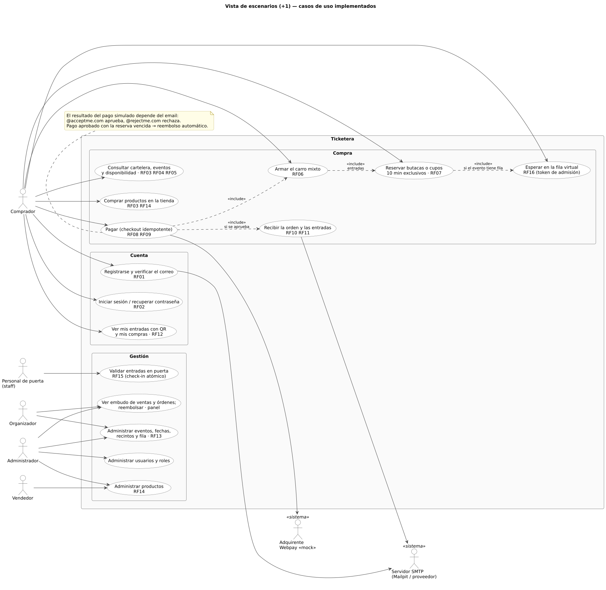
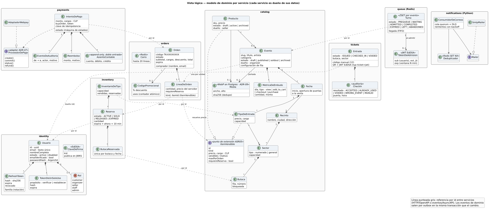
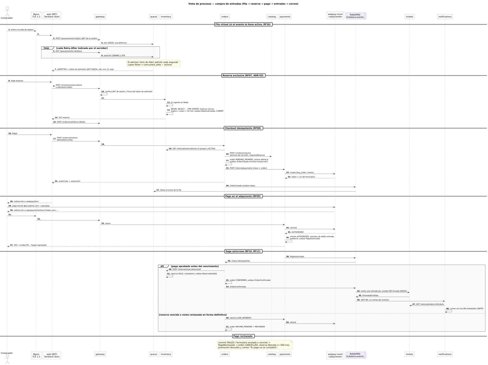
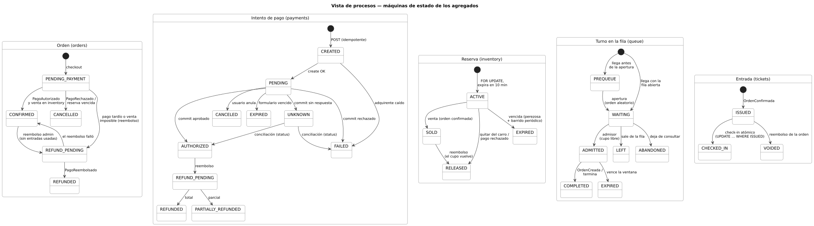
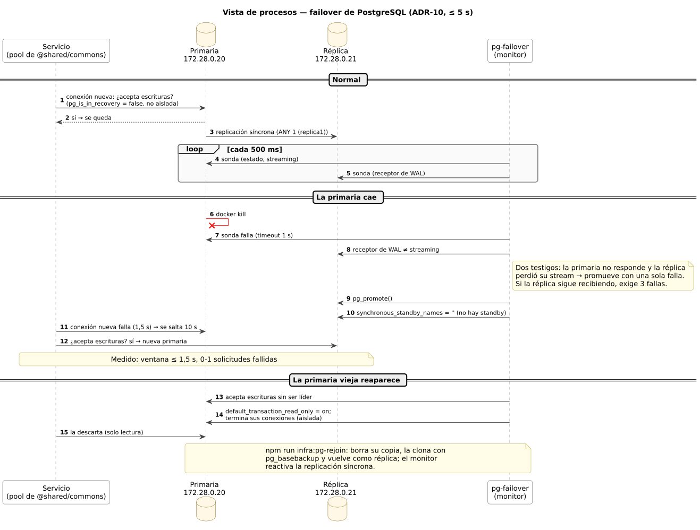
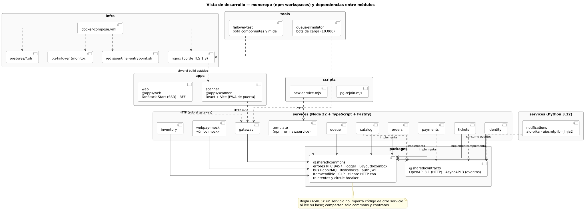
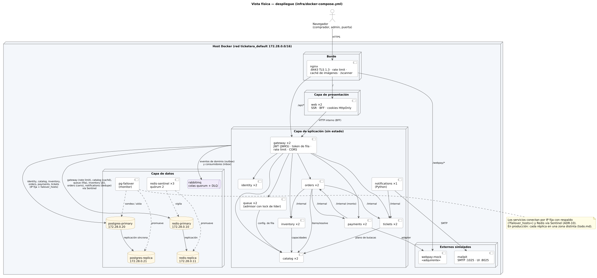

# Diagramas UML — modelo 4+1 del sistema implementado

Los diagramas de [`docs/architecture`](../architecture/README.md) describen la arquitectura **propuesta**
en la presentación del curso. Estos describen el sistema **tal como quedó implementado** al cierre de la
Fase 8: servicios reales, estados reales de la base, flujos medidos y despliegue de
`infra/docker-compose.yml`.

Están escritos como código con [PlantUML](https://plantuml.com) (`src/*.puml`) y se renderizan a SVG
(`svg/`) con la imagen oficial de Docker, sin Java ni servicios externos:

```bash
npm run docs:uml
```

Si cambias el código de modo que un diagrama queda desactualizado, edita su `.puml` y vuelve a
renderizar. El CI renderiza todo para validar la sintaxis.

| Vista             | Diagrama                                               | Muestra                                                                                      |
| ----------------- | ------------------------------------------------------ | -------------------------------------------------------------------------------------------- |
| **+1 Escenarios** | [Casos de uso](svg/01-escenarios.svg)                  | Actores (comprador, organizador, vendedor, personal de puerta, admin) y los RF implementados |
| **Lógica**        | [Modelo de dominio](svg/02-logica.svg)                 | Entidades por servicio, `ItemVendible` como punto de extensión y referencias solo por id     |
| **Procesos**      | [Compra de entradas](svg/03-procesos-compra.svg)       | Fila → reserva → checkout → Webpay → saga por eventos → entradas → correo                    |
| **Procesos**      | [Máquinas de estado](svg/04-procesos-estados.svg)      | Orden, intento de pago, reserva, turno de la fila y entrada                                  |
| **Procesos**      | [Failover de PostgreSQL](svg/05-procesos-failover.svg) | Detección, promoción, aislamiento de la primaria vieja y reincorporación (ADR-10)            |
| **Desarrollo**    | [Monorepo](svg/06-desarrollo.svg)                      | Workspaces (apps, services, packages, tools, infra) y sus dependencias                       |
| **Física**        | [Despliegue](svg/07-fisica.svg)                        | Contenedores, réplicas, IP fijas de los nodos con estado, Sentinel y monitor de failover     |

## +1 Escenarios



## Vista lógica



## Vista de procesos







## Vista de desarrollo



## Vista física


